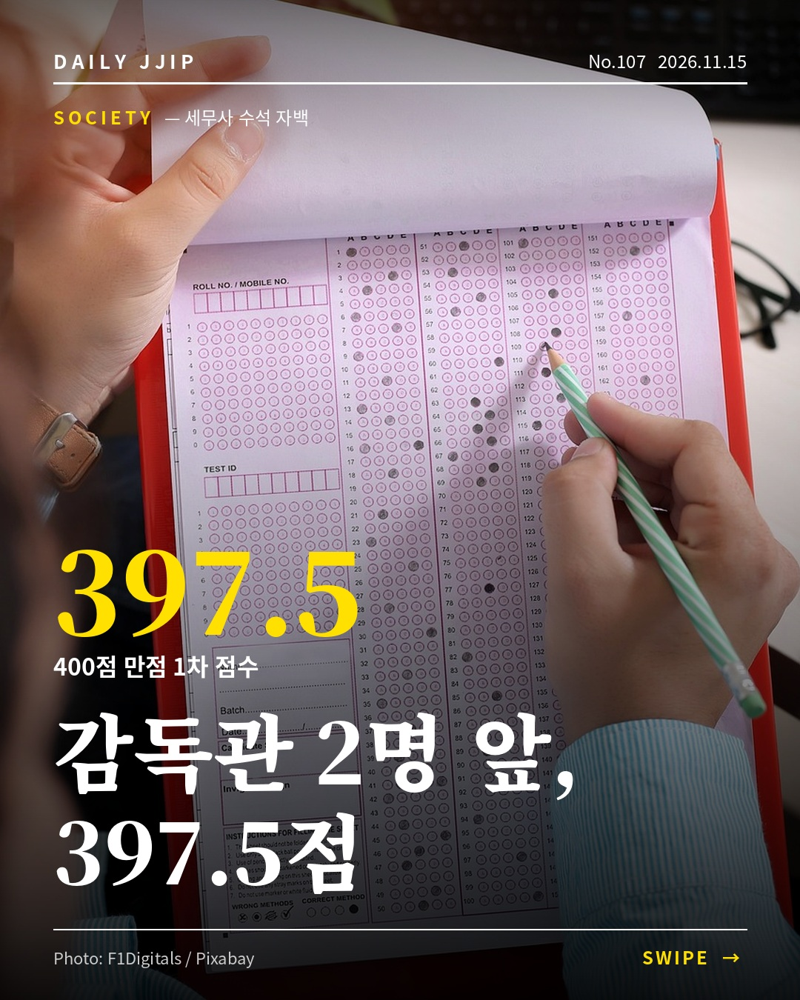

# 오늘의 전용 릴스 (11/25 20:45 생성)

**마트에 상품 살 돈이 없다**

1. [영상 받기](https://raw.githubusercontent.com/dailyjjip/daily-jjip/main/reels/latest.mp4) → 길게 눌러 저장
2. 인스타 앱 → 릴스 → 영상 선택 → 음악(추천곡) 지정
3. 아래 캡션 복사해서 붙여넣기 → 공유



## 캡션

```
홈플러스 임시휴업, 27일부터 무슨 일이 벌어질까? 기업회생 중인 홈플러스가 상품 매입 자금 부족으로 전국 67개 대형마트 영업을 멈춘다. 온라인 배송은 하루 앞선 26일 중단되고, 직원 급여는 아직 밀려 있다. 재개 시점은 M&A에 달렸다. 장 볼 곳이 걱정된다면 저장해 두고, 주변과 공유해 보자.

💬 문 닫은 마트, 살려야 할까?
A. 살려야 한다  vs  B. 정리가 맞다
댓글로 여러분 생각을 남겨주세요 👇

📌 매일 오늘의 이슈를 찝어드려요 → @daily.jjip

#홈플러스 #홈플러스휴업 #대형마트 #기업회생
```
