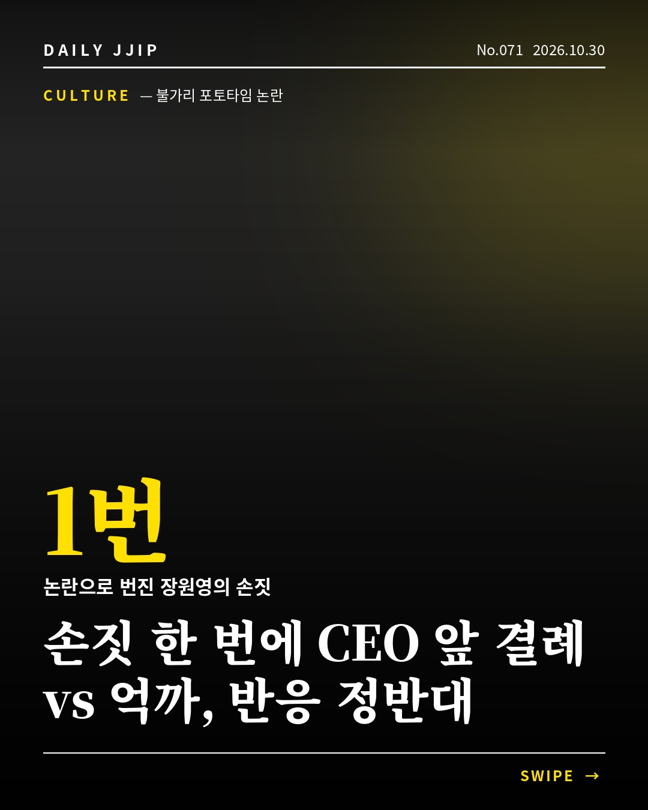

# 오늘의 전용 릴스 (10/30 12:25 생성)

**손짓 한 번에 CEO 앞 결례 vs 억까, 반응 정반대**

1. [영상 받기](https://raw.githubusercontent.com/dailyjjip/daily-jjip/main/reels/latest.mp4) → 길게 눌러 저장
2. 인스타 앱 → 릴스 → 영상 선택 → 음악(추천곡) 지정
3. 아래 캡션 복사해서 붙여넣기 → 공유



## 캡션

```
장원영 불가리 포토타임 논란, 무슨 일이었을까요? 28일 서울 청담동 불가리 전시 프리뷰 행사에서 장원영이 김지원을 옆자리로 부르는 장면이 온라인에서 퍼졌습니다. 일부는 CEO 앞에서 결례가 아니냐고 했고, 다른 쪽은 현장 소통을 지나치게 확대 해석한다고 맞섰어요. 여러분 생각은 어느 쪽인가요? 저장해두고 친구와 의견을 나눠보세요.

💬 포토타임 자리 이동, 결례일까?
A. 결례일 수 있다  vs  B. 과한 해석이다
댓글로 여러분 생각을 남겨주세요 👇

📌 매일 오늘의 이슈를 찝어드려요 → @daily.jjip

#장원영 #불가리 #아이브 #김지원
```

## 댓글용 한 줄 (10/30)
같은 주제의 인기 게시물(대형 뉴스·정보 계정)이 올라온 직후 30분 안에 붙여넣기. 하루 3~5개, 서로 다른 계정에.

**수도권 신규택지 7.7만호, 입주는 2033년 이후**
```
경기 6곳 7만6700가구에 8월 물량까지 합치면 10만3900가구인데, 첫 입주가 2033년이면 기다림이 꽤 길겠네요.
```

**시급 2만7000원 로봇 개 산책 알바**
```
목적은 산책이 아니라 도심 주행 데이터 수집이었네요. 시급 20달러에 고장 난 로봇 15kg을 들고 돌아오는 일이라니, 로봇을 가르치는 건 아직 사람이라는 말이 실감 납니다.
```

**삼성전자 3분기 영업이익 107조, 주가는 -4%**
```
30조 배당은 확정됐지만 나머지 55~75조는 내년 1월 말에야 정해진다니, 시장이 구체성에 반응한 것 같아요. 같은 날 하이닉스가 60조 환원을 내놓은 게 비교가 됩니다.
```
