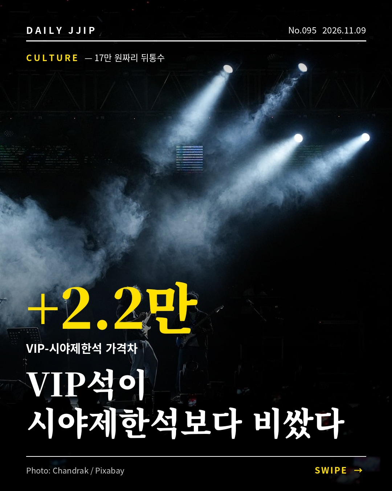

# 오늘의 전용 릴스 (11/10 12:29 생성)

**공지 7일 뒤, 제작발표회**

1. [영상 받기](https://raw.githubusercontent.com/dailyjjip/daily-jjip/main/reels/latest.mp4) → 길게 눌러 저장
2. 인스타 앱 → 릴스 → 영상 선택 → 음악(추천곡) 지정
3. 아래 캡션 복사해서 붙여넣기 → 공유



## 캡션

```
이도 강의 중단 논란, 왜 이렇게 뜨거울까요? 수능 3주 전 건강을 이유로 남은 강의를 멈추겠다고 공지한 지 일주일 만에 넷플릭스 예능 제작발표회에 참석한 사실이 알려졌습니다. 이투스는 11월 9일 공식 사과문을 냈지만 예능 출연 경위에는 언급이 없었습니다. 건강 사유의 휴식과 외부 활동, 어디까지 허용돼야 할까요? 저장해두고 친구와 의견을 나눠보세요.

💬 건강 휴식 중 외부 활동, 괜찮다?
A. 활동은 별개다  vs  B. 휴식 취지 어긋나
댓글로 여러분 생각을 남겨주세요 👇

📌 매일 오늘의 이슈를 찝어드려요 → @daily.jjip

#이도 #이투스 #수능 #강의중단
```

## 댓글용 한 줄 (11/10)
같은 주제의 인기 게시물(대형 뉴스·정보 계정)이 올라온 직후 30분 안에 붙여넣기. 하루 3~5개, 서로 다른 계정에.

**강남 밖 고액월세 300만원 확산**
```
강남3구 고액월세는 3899건에서 3896건으로 3건 줄었어요. 늘어난 건 나머지 22개 구 몫이라, 강남 얘기만 하면 절반은 놓치는 셈이죠.
```

**배달앱 잠정 과징금 3311억·3008억**
```
공정위 분석대로면 2만5천 원 주문 기준 배민 가게배달 메뉴가 1650원 오른 셈이네요. '가격 맞추기' 요구의 비용이 결국 소비자에게 넘어갔다는 얘기죠.
```

**악뮤 강릉 콘서트 플로어 VIP석 시야 논란**
```
VIP가 시야제한석보다 2만2천 원 비싸다는 게 핵심이에요. 단차 없는 평지 구조라면 등급 값을 하는지부터 따져볼 문제 같아요.
```
